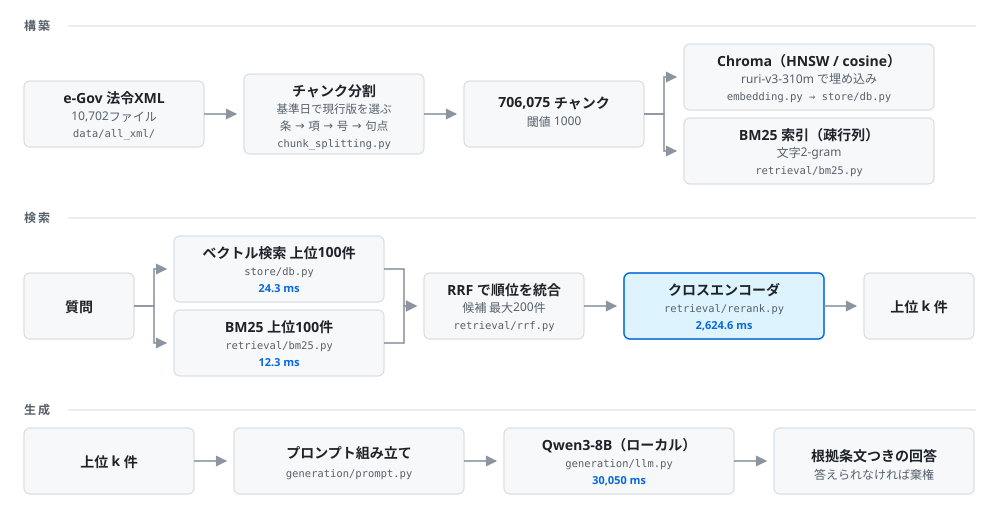

# あなたに関係ある法律チェッカー

**e-Gov の法令XML 全件（8,997法令 / 70万チャンク）を対象に、ローカル完結のRAGで
「根拠条文つきの回答」と「答えられないときの棄権」を検証したプロジェクト。**

検索の評価は、全件から作った**5万チャンクのサブセット**で行っている
（理由は[規模](#規模)の節）。

設計上の判断は **ADR** に記録している。却下した選択肢、その理由、
そして**残っている欠点**を各ADRに書いた。

---

## 何を解決しようとしたか

DV被害者向けの相談チャットAIを、チームのポートフォリオとして開発した
（担当はバックエンド）。そこで法律の知識を持たせた RAG を検討したとき、
**法律はもともと人を守るために書かれているのに、それを必要としている人に届いていない**と感じた。

介護事業の立ち上げを考えていた時も、同じ壁に当たった。
リーガルチェックが大きなボトルネックだった。
**どんな法律が関係するのかを事前に知れていれば、心理的にもずっと楽に進められた。**

条文は公開されていて、誰でも読める。読めるのに届かないのは、
**「自分に関係あるのはどれか」を引く手段が無いから**である。
そこだけを解く道具として作った。

```
法令は検索しづらい     条文は読めるが「自分に関係あるか」が分からない
一般のLLMは創作する   実測: 50問すべてで架空または誤った根拠を提示した
データは公開されている e-Gov が全件XMLで配布している。構造がある
企業で使うなら         外部送信は許されない → ローカル完結が要件になる
```

想定ユーザーは、新規事業を立ち上げるにあたって法律が気になっている事業者。
困りごとは「何を調べればいいか分からない」「抜けがないか確信が持てない」。

---

## 測定結果

### RAGを入れる前と後（50問、人手判定）

**この判定での「RAGあり」は、ベクトル検索のみの構成である**
（`eval_human_20261020.csv`）。BM25・RRF・リランキングは判定後に実装したので、
下の表には入っていない。検索の指標では
Recall@10 が 0.7375 → 0.8750 まで上がっているが、
**その構成で生成を作り直して判定し直してはいない。**

| 判定 | RAGなし | RAGあり（ベクトル検索のみ） |
|---|---|---|
| ○ 条番号・内容ともに正しい | 0 | **11** |
| △ 内容は正しいが項番号の誤り等 | 0 | **11** |
| × 実在の条文だが結論か根拠が誤り | 0 | 14 |
| 創作 条文に無い内容を根拠にした | **50** | 10 |
| 棄権 答えられないと述べた | 0 | 4 |

**RAGなしは50問すべてで創作した。** 存在しない「クーリング・オフ制度に関する法律」
や「賃貸借契約法」を根拠として挙げ、介護保険法の「第355条」を引いた。
**同法の本則は第215条までしかない。**

判定基準と全件の記録は [ADR-0046](docs/adr/0046-human-judgment.md) にある。

### 創作は検索の失敗の症状だった

50問を、**正解の条文が検索の上位10件に入ったかどうか**で分けた
（`convert_jsonl_to_csv.py` が `圏外(検索失敗)` と順位を書き分けている）。
不可答5問は gold が無く「届いた／届かなかった」が定義できないので、
この表からは外してある。だから母数が 45 になる。

```
50問 = 検索が届いた 36 + 届かなかった 9 + 不可答 5
                   └──────── 45 ────────┘
```

| | 問数 | 創作率 | ○+△ |
|---|---|---|---|
| 検索が届いた | 36 | **5.6%**（2/36） | 61%（22/36） |
| 検索が届かなかった | 9 | **78%**（7/9） | **0%**（0/9） |
| （不可答） | 5 | 20%（1/5） | 棄権 4/5 |

**創作率が14倍違う。そして検索が届かなかった9問に ○ も △ も1問もない。**

```
検索は必要条件である      届かなければ 0 / 9
検索は十分条件ではない    届いても 22 / 36
```

この2行が、改善の投資先を検索に決めた根拠である。

### 検索の4方式（条文型40問）

評価セットの45問は、**gold の細かさが2種類ある**ので分けて集計している。
以下は本書での呼び名で、一般的な用語ではない。

| 呼び名 | 問数 | gold の形 | 例 |
|---|---|---|---|
| **条文型** | 40 | 法令 **＋ 条番号** まで指定 | 食品衛生法 第55条 |
| **状況型** | 5 | **法令のみ**（条は問わない） | 介護保険法、建築基準法 |

状況型は `eval_set.jsonl` の `category` が `situation` の5問で、
「訪問介護の事業所を立ち上げたい。どんな法律が関係するか」のように
**条を特定できない問いのために用意した。**
正解の粒度が違うので、同じ Recall として足し合わせない。

コレクション `ruri-v3-310m_1000_20261013_50055`（5万チャンク）。
各検索100件を取得し、RRFで統合（最大200件）、クロスエンコーダで並べ替え。

| 方式 | MRR@100 | Recall@1 | Recall@3 | Recall@5 | Recall@10 | Recall@20 | Recall@30 | Recall@50 | Recall@100 |
|---|---|---|---|---|---|---|---|---|---|
| ベクトルのみ | 0.5932 | 0.4375 | 0.6250 | 0.7000 | 0.7375 | 0.7375 | 0.7875 | 0.8625 | 0.8875 |
| BM25のみ | 0.3034 | 0.2000 | 0.3000 | 0.3375 | 0.4125 | 0.5625 | 0.6000 | 0.7125 | 0.7875 |
| ハイブリッド（RRF） | 0.5009 | 0.2875 | 0.5250 | 0.6500 | 0.7750 | 0.8625 | 0.8625 | 0.8625 | 0.9625 |
| **＋リランキング** | **0.8113** | **0.6875** | **0.8125** | **0.8625** | **0.8750** | **0.9250** | **0.9500** | **0.9625** | **0.9750** |

**リランキングで Recall@1 が 0.2875 から 0.6875 になった。**
ベクトル単体の 0.4375 と比べても +0.25 で、40問中 **10問ぶん**が新たに1位で引ける
（gold 2条の問題は 0.5 刻みなので、問題数は10とは限らない）。

20位以降を並べると、**方式ごとに「どこで伸びるか」が違う**ことが見える。

```
ベクトル   Recall@10 と Recall@20 が同じ 0.7375。11〜20位には1件も無い
BM25      Recall@10 0.4125 → Recall@20 0.5625。上位は弱いが下位に正解を持っている
ハイブリッド Recall@20 以降 0.8625 で止まり、Recall@100 で 0.9625 に跳ねる
```

**BM25 が「上位は弱いが持ってはいる」のが、リランキングが効いた理由である。**
ハイブリッドが候補として拾い、リランカーが上に動かした。

### Recall@1 には 0.8875 という天井がある

**Recall@1 は1.0にならない。** 評価セットの40問のうち9問は gold が2条あり、
1件目だけでは半分しか当てられない（`evaluation/rag/metrics.py` の
`calculate_recall_at_k` は `正解数 / len(gold)` を返す）。

```
gold 1条の問題   31問 × 1.0
gold 2条の問題    9問 × 0.5
                 ───────────
                 35.5 / 40 = 0.8875   ← 指標の定義から来る上限
```

```
ハイブリッド 0.2875 → リランキング後 0.6875（上限 0.8875）
```

ただし 0.8875 は、**gold が候補200件のどこかに入っていることを前提にした上限**である。
リランカーは候補を並べ替えるだけで、候補に無いものは出せない。
1件も入っていない問題があればその分だけ下がるが、
**候補の中身は測っていないので、実際に到達できる上限は分かっていない。**
（Recall@100 が 0.9750 なのは上位100件の話で、101〜200位にある gold は
これに含まれない。候補に無いことの証明にはならない。）

### 状況型5問（ハイブリッド＋リランキング）

| MRR@100 | Recall@1 | Recall@3 | Recall@5 | Recall@10 | Recall@20 | Recall@30 | Recall@50 | Recall@100 |
|---|---|---|---|---|---|---|---|---|
| 0.9000 | 0.3667 | 0.4667 | 0.4667 | 0.6667 | 0.7667 | 0.7667 | 0.7667 | 1.0000 |

**条文型の表と同じ数字として読めない。** 状況型は gold が法令レベルで2〜3件あるため、
1件しか出せない Recall@1 は構造的に1.0にならない。
条文型の天井が 0.8875 だったのと同じ計算で、こちらの天井は 0.4667 になる。

```
Recall@1 の天井 = 各問の 1/gold数 を平均したもの

ts046  gold 2法令 → 1/2 = 0.5
ts047  gold 2法令 → 1/2 = 0.5
ts048  gold 2法令 → 1/2 = 0.5
ts049  gold 3法令 → 1/3 = 0.3333
ts050  gold 2法令 → 1/2 = 0.5
                    ──────────────
   天井             2.3333 / 5 = 0.4667

実測 Recall@1 = 0.3667 を同じ形に分解すると

   0.5 × 3件 ＋ 0.3333 × 1件 ＋ 0 × 1件 = 1.8333 / 5 = 0.3667
```

gold 2法令の問題は 0 か 0.5、3法令の問題は 0 か 0.3333 しか取れないので、
**この分け方は一通りしかない。**
つまり **5問中4問は1位に gold を置けていて、1問だけ置けていない。**
0.3667 という数字そのものより、この分解のほうが読める。

上の表の Recall@3 も 0.4667 だが、**これは偶然同じ値になっただけで、
天井とは無関係である。** Recall@3 の天井は（gold が3件以下なので）1.0 になる。

ただし5問なので1問の増減で 0.2 動く。傾向としても読まない。

### ハイブリッドは Recall@1 では数値が下がり、Recall@10 では上がっている

| | Recall@1 | Recall@3 | Recall@5 | Recall@10 |
|---|---|---|---|---|
| ベクトル | 0.4375 | 0.6250 | 0.7000 | 0.7375 |
| ハイブリッド | **0.2875** | **0.5250** | **0.6500** | **0.7750** |

**Recall@10 だけが上がり、それより上は全部下がった。**

RRF が足すのは順位そのものではなく、**各リストの順位から出した `1/(60 + 順位)`**
である。この形だと、**両方のリストで上位にあるものが、片方だけで1位のものに勝つ。**

```
片方1位・もう片方4位   1/(60+1) + 1/(60+4) = 0.016393 + 0.015625 = 0.032018
両方2位                1/(60+2) + 1/(60+2) = 0.016129 + 0.016129 = 0.032258  ← 勝つ
```

上位が入れ替わるのはこのためで、Recall@1 は **−0.15**。
逆に10位以内では片方が落としてももう片方が拾えば残るので、Recall@10 は **+0.0375**。

**ハイブリッド単体は、この時点では割に合っていない。**
それでも採用したのは、**リランカーに渡す候補としての価値が別にあるため**である。
Recall@100 はベクトル 0.8875 に対しハイブリッド 0.9625 で、
**候補の中に正解がある率が上がっている。** 並べ替えは後段の仕事になる。

### レイテンシ（1問あたり、中央値）

| 段階 | 時間 | 割合 |
|---|---|---|
| 検索（ベクトル＋BM25＋RRF） | 49.5ms | 0.2% |
| リランキング（候補200件） | 2,624.6ms | 8% |
| 生成（Qwen3-8B、ローカル） | 30,050ms | 92% |

**生成が9割を占める。**
検索とリランキングは `hybrid-rerank` の同じ回から取っている。
ハイブリッド単体の回では検索が 31.4ms で、同じコードなのに 18.1ms 速い。
**原因は特定できていない**。

### RAGなしの回答は1.7倍長い

| | RAGあり | RAGなし |
|---|---|---|
| 出力トークンの中央値 | **414** | **687** |
| 出力トークンの最大 | 1,149 | 2,048 |
| トークン上限に達した数 | 0 / 50 | 2 / 50 |
| 1問あたりの生成時間（中央値） | 30.05秒 | 38.28秒 |

**根拠を持たないモデルは短く答えられない。** 人手判定の「RAGなしは50問すべて創作」と
同じ現象を、トークン数という機械的な量で見たものになっている。
2問は上限に当たって文の途中で切れた。

### この節の数字の出どころ

すべて `evaluation/results/` に残っている。

| 上の表 | ファイル |
|---|---|
| 人手判定・創作率 | `eval_human_20261020.csv` |
| 出力トークン・生成時間 | `generation_rag_20261020.jsonl` / `generation_norag_20261020.jsonl` |
| 検索4方式・レイテンシ | `retrieval_ruri-v3-310m_1000_20261013_50055_{vector,bm25,hybrid,hybrid-rerank}_2026110*.jsonl` |
| 閾値200 | `retrieval_ruri-v3-310m_200_20261013_50045_hybrid-rerank_20261107-2229.jsonl` |

**人手判定とトークン数は同じ回**である（`eval_human_20261020.csv` の回答文と
jsonl のトークン数が、文字数で約1.5倍の比で一致する）。

生成は**思考モードOFF**で測っている。Qwen3 の非思考モードの推奨値
（temperature 0.7 / top_p 0.8 / top_k 20）を使い、`<think>` ブロックは1件も出ていない。

閾値200のコレクションは 50,045 チャンク、閾値1000は 50,055 チャンクで10件違う。
サブセットの作り方から出る誤差で、比較には影響しない。

---

## 設計の制約と、それが決めたこと

| 制約 | 決まったこと | ADR |
|---|---|---|
| **外部に送信しない** | Chroma の `CloudClient` を使わない。マネージドサービスを採用しない | [0023](docs/adr/0023-local-llm.md), [0024](docs/adr/0024-vector-store.md) |
| **GPU専用メモリが無く、全モデルが36GBを分け合う** | 埋め込みは315M・768次元に収める。ベンチマーク上位の8Bモデルを却下 | [0041](docs/adr/0041-embedding-model.md) |
| **Apple Silicon（MPS）で動かす** | CUDA必須・FlashAttention-2前提のモデルが使えない | [0041](docs/adr/0041-embedding-model.md) |
| **検索対象が日本語の法令文** | 形態素解析器を使わず文字2-gram。法令用語は一般の辞書に無い | [0049](docs/adr/0049-bm25-tokenizer.md) |
| **法令は改正される** | 基準日を定数で固定し、比較実験の間コーパスを動かさない | [0040](docs/adr/0040-corpus-reference-date.md) |
| **検索方式が評価対象である** | BM25・RRF・リランキングを自前実装。統合フレームワークを使わない | [0010](docs/adr/0010-no-rag-framework.md), [0025](docs/adr/0025-hybrid-search.md) |

**「外部に送信しない」は、比べたうえで選んでいる。**
同じ質問・同じシステムプロンプトで外部APIモデル（Gemini）を
思考レベル3段階 × 3回測り、レイテンシ・トークン数・**料金（USD）**まで出した
（`evaluation/llm/gemini_bench.py`、結果は `evaluation/results/` のCSV）。

```
ローカル    30.05秒/問、料金は発生しない、データは外に出ない
```

外部APIを使わない判断は要件から決まっているが、**何を手放したのかは数字で把握している。**
なお、この比較自体は開発時の測定であって、**利用時の経路に外部通信は無い**
（[ADR-0023](docs/adr/0023-local-llm.md)）。

---

## アーキテクチャ



箱の下がその段を担当するファイル、青字が1問あたりの実測時間（中央値）。
構築は `evaluation/build_eval_index.py`、
検索は `evaluation/rag/evaluate_retrieval.py`、
生成は `evaluation/evaluate_generation.py` から呼び出している。
XMLを開いて現行版を選び、チャンクに切るまでが `src/ingestion/chunk_splitting.py`。

### 規模

| | 件数 |
|---|---|
| 法令ファイル | 10,702（ユニークな法令ID 8,997） |
| 現行版の全件チャンク | 706,075（閾値1000） |
| 評価用サブセット | 50,055 |
| 評価セット | 50問（可答45 / 不可答5） |

**サブセットを使っている理由**は、全件投入の時間を比較実験のサイクルに
乗せられないため。gold の法令は必ず含める設計にした
（[ADR-0033](docs/adr/0033-evaluation-subset.md)）。

---

## 評価の設計

評価セットは `evaluation/rag/eval_set.jsonl` に50問。
1問が `question` / `category` / `answerable` / `gold` / `gold_answer` / `note` を持つ。

### 9つのカテゴリで、検索が壊れる場所を分けて測る

| category | 問数 | 何を測るか |
|---|---|---|
| `fact` | 10 | 条文の内容をそのまま問う。基本形 |
| `number` | 5 | 日数・年齢・期間。**混同しやすい数字**を正しく回答できるか |
| `negation` | 5 | ただし書・適用除外。**読み落とすと結論が逆になる** |
| `comparison` | 5 | 2つの制度の違い。複数条文が要る |
| `multi_doc` | 5 | **2箇所を組み合わせないと答えにならない**。同じ条の別の項のこともある |
| `long` | 5 | 長い相談文。**条文に無い情報がノイズとして混ざる** |
| `summary` | 5 | 複数項目をまとめて列挙させる |
| `situation` | 5 | 状況から関係法令を特定。**プロダクト本来の用途** |
| `unanswerable` | 5 | 法令XMLに答えが無い。**棄権を測る** |

gold は6法令（特定商取引法・介護保険法・都市計画法・消防法・建築基準法・
食品衛生法）に分布している。条文型40問のうち9問、状況型5問すべてが
**gold を複数持つ**（合計14問）。

### 評価データを先に凍結した

実装の前に評価セットを作り、以後変更しないと決めた
（[ADR-0036](docs/adr/0036-freeze-eval-data-first.md)）。
**結果を見てから評価データを直すと、スコアは上がるが意味を失う。**

### 指標は Recall@k と MRR に限った

nDCG と Precision@k を検討して却下している
（[ADR-0037](docs/adr/0037-retrieval-metrics.md)）。
どちらも、**この評価データでは指標の持ち味が出ない**という理由である。

### 偶然当たる確率が、型によって桁違いに違う

```
条文型   gold は特定の条。その条のチャンクを引かないと当たらない
         長い条は複数チャンクに分かれるので的は1件とは限らないが、
         5万件の中ではいずれにせよごく一部

状況型   gold は法令まるごと。その法令に属するチャンクを
         1件でも引けば当たる。大きい法令ほど当たりやすい
```

**同じ数字でも、問題の型によって意味が全く違う。**
だから条文型と状況型を足し合わせず、別々に報告している。

---

## 測定で分かったこと

### リランキングは、精度を上げながら文脈を減らせる
 
**ベクトル検索で10件渡すより、リランキングして3件渡す方が正解率が高い。**
 
```
ベクトルのみ    Recall@10 = 0.7375    LLMに10件渡す
＋リランキング   Recall@3  = 0.8125    LLMに 3件渡す
```
 
プロンプトが1/3になって、正解が入っている率は上がる。
生成がレイテンシの9割を占めるので、**渡す件数が減ることはそのまま速度に効く。**
 
### 生成に渡すのは5件で足りる
 
リランキング後の件数ごとの Recall を並べると、増やす価値が落ちる場所が見える。
 
| 渡す件数 | Recall | 1件増やしたときの伸び |
|---|---|---|
| 1件 | 0.6875 | — |
| 3件 | 0.8125 | +0.0625 /件 |
| 5件 | 0.8625 | +0.0250 /件 |
| 10件 | 0.8750 | +0.0025 /件 |
| 20件 | 0.9250 | +0.0050 /件 |
 
**5件から10件に増やしても +0.0125 しか増えない。** 文脈は倍になる。
20件まで増やすと +0.0625 取れるが、1件あたり最大1000字なので
**2万字をプロンプトに積むことになる。**
 
現在の `GENERATION_K` は10。5件に下げても検索側の損失はほぼ無い。
**ただし生成の正解率がどう動くかは測っていない。** 文脈が減ると
LLMが答えを組み立てられなくなる可能性があり、そこは別の実験になる。
 
### チャンクは、割らずに済むなら割らない

閾値を200にすると、閾値を超える条が増え、分割が深くなる。
どちらも `hybrid-rerank`、条文型40問。
 
| | MRR@100 | Recall@1 | Recall@3 | Recall@5 | Recall@10 | Recall@20 | Recall@30 | Recall@50 | Recall@100 |
|---|---|---|---|---|---|---|---|---|---|
| 閾値200 | 0.6924 | 0.5500 | 0.6875 | 0.7000 | 0.8250 | 0.9125 | 0.9375 | 0.9500 | 0.9750 |
| 閾値1000 | 0.8113 | 0.6875 | 0.8125 | 0.8625 | 0.8750 | 0.9250 | 0.9500 | 0.9625 | 0.9750 |
| **差** | −0.1189 | −0.1375 | −0.1250 | −0.1625 | −0.0500 | −0.0125 | −0.0125 | −0.0125 | **0.0000** |
 
**差は上位ほど大きく、kが増えるほど縮み、Recall@100 でゼロになる。**
正解は候補の中に同じだけ入っている。**順位が付けられないだけである。**
 
状況型5問は、同じようには動かない。
 
| | MRR@100 | Recall@1 | Recall@3 | Recall@5 | Recall@10 | Recall@20 | Recall@30 | Recall@50 | Recall@100 |
|---|---|---|---|---|---|---|---|---|---|
| 閾値200 | 0.7667 | 0.3000 | 0.4667 | 0.4667 | 0.5667 | 0.7667 | 0.7667 | **0.8667** | 0.8667 |
| 閾値1000 | 0.9000 | 0.3667 | 0.4667 | 0.4667 | 0.6667 | 0.7667 | 0.7667 | 0.7667 | **1.0000** |
| **差** | −0.1333 | −0.0667 | 0.0000 | 0.0000 | −0.1000 | 0.0000 | 0.0000 | **+0.1000** | −0.1333 |
 
**Recall@50 では閾値200の方が高い。** 条文型のように一方向には動かない。

5問しかないので、**1問の増減で 0.2 動く。** この並びから傾向は読まない。
読めるのは1点だけで、**状況型は閾値200にすると Recall@100 が落ちる**こと
（1.0000 → 0.8667）。条文型は閾値を変えても 0.9750 のまま動かなかった。

条文型でこの値が動かないことには意味がある。
**閾値を変えても、候補100件の中に入る正解の量は変わっていない。**
落ちているのは上位の成績だけである。

短い断片ほど、条文全体を問う質問との一致が弱くなる——というのが自然な説明だが、
**そこは測っていない。** 言えるのは「閾値1000の方が上位の成績が良い」までで、
閾値1000を採用した。

---

## 技術スタック

| | 採用 | 理由 |
|---|---|---|
| 埋め込み | `cl-nagoya/ruri-v3-310m` | 日本語特化。315M・768次元で生成LLMと同居できる |
| リランカー | `cl-nagoya/ruri-v3-reranker-310m` | 埋め込みと同系列で、生成LLMと同居できるサイズ。実測で Recall@1 を 0.2875 → 0.6875 に上げた |
| キーワード検索 | 自前実装（文字2-gram + BM25） | 法令用語が一般の辞書に無いため形態素解析を使わない |
| 統合 | 自前実装（RRF） | スコアの単位が違うため順位で統合する |
| ベクトルDB | Chroma（ローカル） | 外部送信なしで完結。HNSW / cosine |
| 生成 | `Qwen/Qwen3-8B`（bf16 / 思考モードOFF） | **量子化せずに載る大きさ**で選んだ。27Bクラスは bf16 なら54GBになり載らない |
| 実行環境 | Apple Silicon M4 Max / 36GB | — |
| データ | e-Gov 法令XML 全件 | 一次情報。法令名・条番号・施行日が構造化されている |

---

## 動かし方

### 動作環境

測定はすべてこの環境で行っている。

| | |
|---|---|
| チップ | Apple M4 Max |
| メモリ | 36GB（ユニファイドメモリ） |
| アクセラレータ | MPS（Metal Performance Shaders） |
| OS | macOS 15.7.5 |
| Python | 3.12.13 |
| モデルの精度 | bfloat16 |

**CUDA は使っていない。** NVIDIA GPU 前提のモデルやライブラリは採用できない
（[ADR-0041](docs/adr/0041-embedding-model.md)）。
生成LLM・埋め込み・リランカーの3つを同時に載せるため、
**より小さいメモリで動くかは確認していない。**

### セットアップ
```bash
cd backend
python -m venv .venv
source .venv/bin/activate
pip install -r requirements.txt
```

### 法令データの用意

e-Gov 法令検索の**全法令データ一括ダウンロード**から XML 一式を取得し、
`backend/data/all_xml/` に展開する（[ADR-0001](docs/adr/0001-bulk-download.md)）。
APIで1件ずつ取得する方法も検討したが、全件を扱うため一括取得を選んだ。

```
データの取得日   2026-09-11
基準日           2026-10-13（config.REFERENCE_DATE）
```

**基準日がデータの取得日より32日あとになっている。**
一括ダウンロードのXMLには未施行の改正版も含まれるため、
9月11日時点で公布済みのものは基準日で拾える。
ただし**9月12日以降に公布された改正は、このコーパスに入っていない。**

### 評価用インデックスの構築

```bash
python -m evaluation.build_eval_index --save
```

5万チャンクの投入で約8分。初回はXMLの読み取りとチャンク生成が別途かかる。

### 構築したコレクションの検品

```bash
python -m evaluation.check_collection ruri-v3-310m_1000_20261013_50055
```

設定に依存しない3つの性質だけを見る（距離のNaN / 異なる質問が同じ結果を返さないか /
必須法令の存在）。順位やRecallは使わない。
**閾値を変えると順位は変わるので、順位を合否にすると「壊れた」と「設定を変えた」が
区別できなくなる**（[ADR-0048](docs/adr/0048-corpus-persistence.md)）。

### 検索の評価

```bash
python -m evaluation.rag.evaluate_retrieval ruri-v3-310m_1000_20261013_50055 --method hybrid-rerank
```

`--method` は `vector` / `bm25` / `hybrid` / `hybrid-rerank`。

`hybrid-rerank` で45問が約2分（1問あたり検索 49.5ms ＋ リランク 2.6秒）。
`vector` と `bm25` は1問あたり数十ミリ秒なので、モデルの読み込み時間が大半を占める。

### 検索時間の集計

```bash
python -m evaluation.compare_retrieval evaluation/results/retrieval_*_20261105-*.jsonl
```

### 生成の評価

```bash
python -m evaluation.evaluate_generation   # USE_RAG = True / False で切り替え
```

50問で約26分（`generation_rag_20261020.jsonl` の合計 1,529.5秒）。

---

## ディレクトリ構成

```
Your_Law/
├── README.md
├── docs/
│   ├── adr/                           設計判断の記録 49本
│   └── images/architecture.svg
└── backend/
    ├── requirements.txt
    ├── build_index.py                 全件インデックスの構築
    ├── data/all_xml/                  e-Gov 法令XML
    ├── src/
    │   ├── config.py                  定数。基準日・モデル名・閾値・k
    │   ├── api/law_data.py            e-Gov 法令APIの動作確認（コーパス取得には未使用）
    │   ├── ingestion/
    │   │   ├── text_extraction.py     要素からテキストを取り出す。ルビ（Rt）は除く
    │   │   ├── chunk_splitting.py     XMLを読む。基準日で現行版を選び、条→項→号→句点に分割
    │   │   └── sub_set.py             評価用サブセットの作成
    │   ├── embedding/embedding.py     埋め込みモデルの読み込みと実行
    │   ├── store/db.py                Chroma の操作
    │   ├── retrieval/
    │   │   ├── bm25.py                文字2-gram + BM25（自前実装）
    │   │   ├── rrf.py                 2つの順位リストの統合
    │   │   └── rerank.py              クロスエンコーダ
    │   └── generation/
    │       ├── llm.py                 LLMの読み込みと生成
    │       └── prompt.py              プロンプトと文脈の組み立て
    ├── evaluation/
    │   ├── rag/
    │   │   ├── eval_set.jsonl         評価セット50問（実装前に凍結）
    │   │   ├── broken_eval_set.jsonl  検証用。意図的に壊した評価データ8件
    │   │   ├── eval_data.py           評価セットの読み込み
    │   │   ├── metrics.py             Recall@k / MRR / find_rank
    │   │   └── evaluate_retrieval.py  検索の評価（4方式）
    │   ├── llm/
    │   │   ├── measure.py             RAMとMPSのメモリ使用量
    │   │   ├── llm_params.py          生成パラメータの総当たり。TTFT / TPOT / TTFO
    │   │   └── gemini_bench.py        外部APIモデルとの比較。レイテンシとコスト
    │   ├── results/                   測定結果（JSONL / CSV）
    │   ├── build_eval_index.py        評価用コレクションの構築と永続化
    │   ├── check_collection.py        構築したコレクションの検品
    │   ├── compare_retrieval.py       検索時間の集計
    │   ├── convert_jsonl_to_csv.py    人手判定用のCSVを組み立てる（判定列は空）
    │   ├── evaluate_generation.py     生成の評価（RAGあり / なし）
    │   └── summarize_results.py       生成結果の集計
    └── scripts/
```

---

## 設計判断の記録（ADR）

`docs/adr/` に **49本**。MADR のミニマル版で、各ADRに
**却下した選択肢・その理由・残っている欠点**を書いている。

### 特に読んでほしいもの

| ADR | 内容 |
|---|---|
| [0036](docs/adr/0036-freeze-eval-data-first.md) | 評価データを実装前に凍結した理由 |
| [0037](docs/adr/0037-retrieval-metrics.md) | 指標の選定。nDCG と Precision を却下した理由 |
| [0041](docs/adr/0041-embedding-model.md) | ベンチマーク上位のモデルを制約で却下した判断 |
| [0046](docs/adr/0046-human-judgment.md) | 5段階の人手判定。LLM-as-a-Judge を使わなかった理由 |
| [0048](docs/adr/0048-corpus-persistence.md) | 検品を「設定に依存しない性質」だけで行う設計 |
| [0049](docs/adr/0049-bm25-tokenizer.md) | 形態素解析を使わず文字2-gramを選んだ理由 |

---

## 限界と、次にやること

| 限界 | 内容 |
|---|---|
| **重複チャンクを直していない** | 同一テキストのチャンクが大量にあり（`この省令は、公布の日から施行する。` が10,341件）、同じベクトルになって検索の上位を占める。閾値2000のコーパスで32.1%。埋め込みに法令名が入っていないのが原因で、前置すれば直るはずだが未実装 |
| **チャンク閾値の比較実験が未完** | 200と1000しか測っていない。500 / 2000 / 8000 が残っている |
| **オーバーラップが未実装** | ADR-0014 で予定したまま |
| **生成の評価が検索の成果を反映していない** | 生成側はベクトル検索のみで、毎回コーパスを再構築している。ハイブリッド＋リランキングを通していない |
| **評価者が条件を知っている** | 人手判定を実装者自身が行い、どちらがRAGありか見えている。盲検にしていない |
| **判定者が1人** | 複数人で判定してκ係数を出すのが筋だが、人手が無い |
| **不可答5問は母数が小さい** | 4/5 と 0/5 の差は明確だが、5問で棄権率を語るのは統計的に弱い |
| **UIが無い** | CLI と評価スクリプトのみ。ADR-0026 で決めた入力形式は未実装 |
| **生成モデルを1つしか試していない** | `Qwen3-8B` で固定。より新しい世代や、量子化して大きいモデルを載せる選択肢を測っていない |

### 次の優先順位

```
1. 重複チャンクの対処（法令名・附則識別子の前置）→ 再測定
2. チャンク閾値とオーバーラップの比較実験
3. 生成の評価をハイブリッド＋リランキングに切り替えて再測定
4. 最小のUI（Gradio）
5. 法改正の通知
```